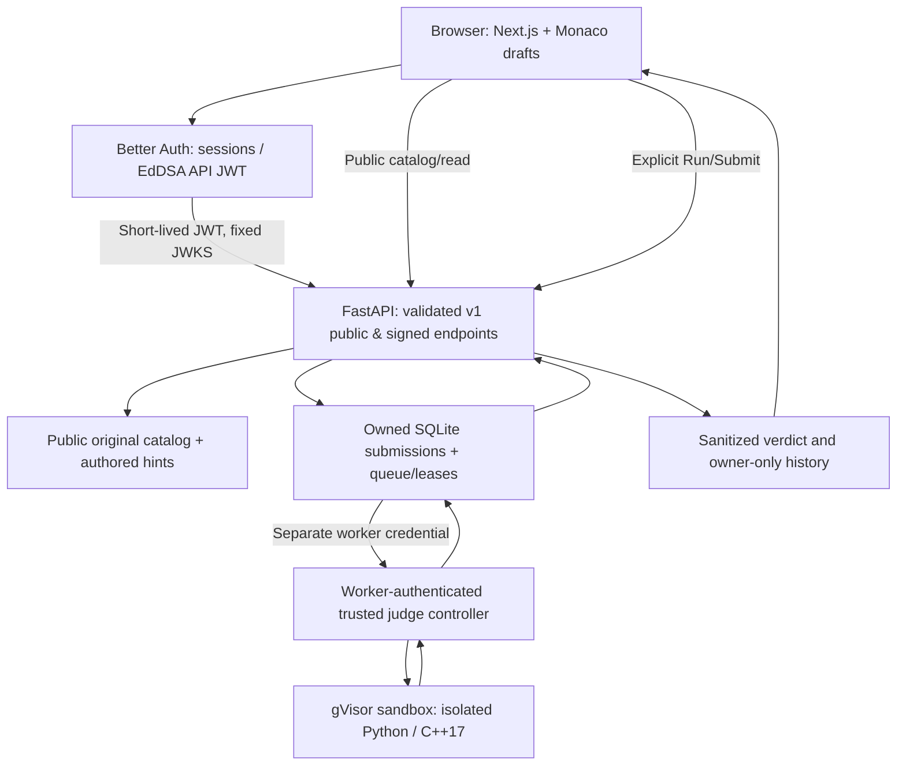
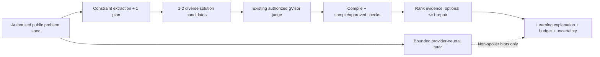
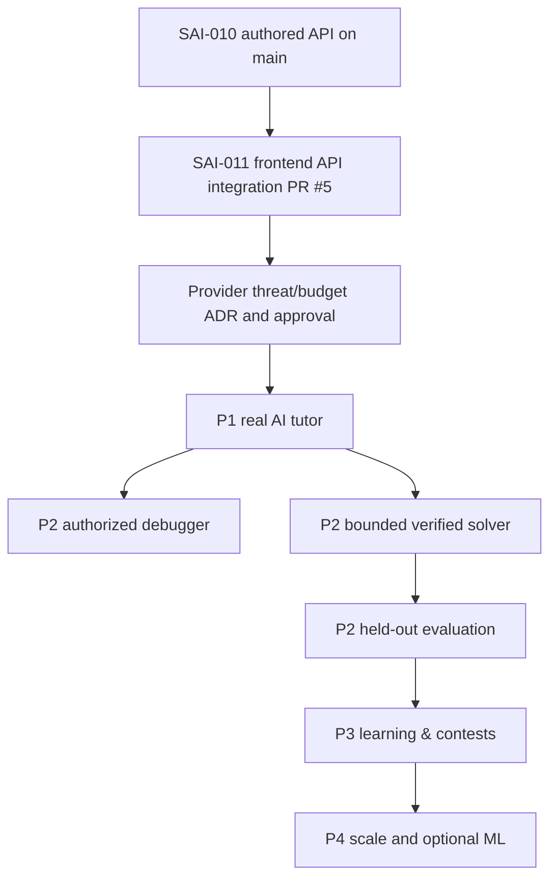

# SOLVER AI — PERMANENT PROJECT MEMORY

**Continuity handbook | 16 November 2026 | GitHub-first source of truth**

> **Every new ChatGPT, Codex or human developer should read this document before writing code.** It consolidates the project purpose, real implementation, research, charts, links, tests, constraints, decisions and next steps. It is a continuity record based on accessible conversation excerpts and GitHub evidence—not a verbatim export of every historical chat. Never treat it as a replacement for inspecting the current source, branch, open PRs and CI.

- **Main repository:** https://github.com/arunabanarjee32-bit/solver-ai
- **Mission:** Build a fully owned, original, commercially viable AI-native DSA/competitive-programming/ICPC practice system that competes on user value with LeetCode, Codeforces, AtCoder, HackerRank and AI coding assistants.
- **Existing foundation:** One Next.js/Monaco + Better Auth + FastAPI + SQLite-owned-submission-queue + gVisor judge monorepo. Do not restart it.
- **Status at this snapshot:** `main` = `9952f8b5fa74f6900d57d1b48e3a26f3e962a358`. SAI-010 signed offline hint backend is **already on main**. SAI-011 authenticated hint frontend and research docs are in successfully tested [PR #5](https://github.com/arunabanarjee32-bit/solver-ai/pull/5), head `b591db142d7b65c306769a59251ed4129f42118a`; **unmerged** as checked 16 Nov.
- **Exactly two primary solver research references:** https://github.com/kagnlp/CodeGenerator (CodeSIM/MapCoder, MIT) and https://github.com/Nan-Do/phi-code (Apache-2.0). Study design patterns only, not unsafe executors.
- **Immediate next step:** Review PR #5 and merge only after maintainer approval; then start threat-model/budget ADR for a real model provider, not paid inference or GPU training.

## A. How to resume in a new chat

Paste [RESUME_PROMPT.md](RESUME_PROMPT.md) into a new session, or ask the agent to read `docs/PROJECT_MEMORY.md` and `docs/MASTER_DEVELOPMENT_SPEC.md`. Every session must:

1. Check the exact current `main` SHA, PRs, branches, workflows, dirty files and permissions. This snapshot can be stale.
2. Read `README.md`, `AGENTS.md`, `docs/INDEX.md`, `docs/PROJECT_STATUS.md` and the actual code/tests before making a plan.
3. Reuse tested functionality; select one narrow task, dependencies, test plan, security policy and rollback; no unnecessary infrastructure, models or rewrite.
4. Implement on a focused branch, run actual tests, record pass/fail/skip, open PR, **do not merge unreviewed work**.
5. Update this handbook, [CHAT_CONTINUITY_LOG](CHAT_CONTINUITY_LOG.md), `PROJECT_STATUS.md` and a one-task handoff with commit/CI links. Exclude secrets, private judge cases, private submitted code and personal data from this public repo.

## B. Project goals, product specification and honesty

**Primary learner journey:** Pick an authorized original problem → read statement, samples and constraints → edit C++17/Python in Monaco → run sample cases → submit to isolated judge → see authentic AC/WA/CE/RE/TLE/MLE/OLE verdict → review owned history → read authored or authenticated hints → eventually obtain true AI tutoring, debugging and validated candidate-solving assistance.

**Differentiation:** Accessible progression from beginner to ICPC, grounded explanations, visible AI provenance, careful counterexample debugging, reproducible solver verification, personalization and affordable access. Competitors are workflow benchmarks, **not code/content sources**.

| Feature | Actual status as of snapshot | Boundary |
| --- | --- | --- |
| Three original seed problems and catalog filtering | On main | Limited seed library; do not claim thousands of tasks |
| Next.js responsive workspace, Python/C++17 Monaco, local drafts | On main | Draft source stays in browser until user chooses Run/Submit |
| Better Auth local accounts and short-lived signed JWT for FastAPI | On main | Production recovery/verification policies unresolved |
| Owner-scoped SQLite submission queue/history and polling | On main | Real local persistence; future scale migration only if warranted |
| gVisor-only isolated judge worker and original generated cases | On main | Locally validated, **not publicly security-certified** |
| Public author-written hint ladder | On main | Not generated by a model |
| Signed `POST /api/v1/hints` | On main (SAI-010) | Currently **authored only**, no model inference |
| Signed-in hint UI / Zod contract / browser tests | In PR #5 (SAI-011) | Implemented and CI-tested; **not merged** |
| Genuine AI tutor, debugger, verified solver | Not implemented | No fabricated model capabilities |
| Learning paths, contests/teams, ratings, leaderboard | Planned | Contest integrity required |
| Paid provider APIs, open-weight fine-tuning, GPU/vLLM, public production deployment | Not implemented / not approved | Need budget, rights, benchmark, release/security gate |

## C. Real repository architecture and request flows

**Top-level:** `apps/web` (Next.js 16/TypeScript/React), `services/api` (FastAPI/Pydantic), `services/judge` (trusted worker and gVisor-only runner), `tests/e2e` (Playwright), `scripts`, `compose.yaml`, `.github/workflows/ci.yml`, `docs`, pinned `package-lock.json` and `services/api/uv.lock`.

### Chart 1 — authenticated learning and execution



**Trust boundaries:** Browser sessions belong to Better Auth, not to the FastAPI service; FastAPI verifies EdDSA signature, fixed issuer, `solver-api` audience and subject. Submission records are scoped to verified user. Only the trusted judge worker leases and completes jobs using its separate credential; generated grading case expectations never go to web/API model context. The worker refuses ordinary-host/ordinary-Docker execution if gVisor preflight fails. No unrestricted `exec`, `eval` or host subprocess for generated/user code.

### Actual code map and important contracts

| Source path | Purpose | Action |
| --- | --- | --- |
| `apps/web/components/workspace.tsx` | Problem, samples, guest authored hints, editor layout | Keep public hint ladder; PR #5 adds account request |
| `apps/web/components/code-pane.tsx` | Monaco/simple editor, per-problem/lang local draft | Never auto-upload draft |
| `apps/web/components/submission-panel.tsx` | Run/Submit, queue state, polling | Preserve cancel and session correctness |
| `apps/web/lib/api.ts` | Zod-verified public catalog request | Strict response schema opt-in |
| `apps/web/lib/submissions.ts` | Short-lived Better Auth JWT and typed API requests | Reuse existing auth pattern |
| `apps/web/lib/auth.ts` and `auth-client.ts` | Session authority, keys, JWT | Avoid second identity service |
| `apps/web/next.config.ts` | Same-origin proxy to API | Keep credential separation |
| `services/api/solver_api/main.py` | Catalog, hint, owned queue, internal worker routes | Keep versioned boundaries |
| `services/api/solver_api/auth.py` | Fixed JWKS EdDSA validation | Fail closed |
| `services/api/solver_api/hints.py` | Signed levels 1–3 and future backend Protocol | **Already on main** |
| `services/api/solver_api/submissions.py` | Owned durable queue, quota, idempotency, leases | Preserve cross-user security |
| `services/judge/solver_judge/runner.py` | gVisor-only isolated execution | No host fallback |
| `services/judge/solver_judge/worker.py` | Trusted worker API and lifecycle | Separate secret |
| `services/judge/solver_judge/cases.py` and `harness.py` | Original grading cases and bounded run | Keep private answers trusted |
| `services/api/tests/test_hints.py` | Auth/provenance/invalid/timeout/backend tests | Existing coverage, do not recreate |
| `tests/e2e/` | Auth, editor, reliability and submission browser tests | Extend focused regressions |
| `apps/web/lib/hints.ts` and `components/account-hint.tsx` | **PR #5 only**, strict account hints UI | Merge with maintainer review |
| `tests/e2e/hints.spec.ts` | **PR #5 only**, guest/auth/authored/mock/model/error tests | CI passed at head SHA |

**Existing endpoints:** `GET /api/v1/problems`; `GET /api/v1/problems/{slug}`; `POST /api/v1/hints`; `GET /api/v1/capabilities`; `POST /api/v1/submissions`; `GET /api/v1/submissions`; `GET /api/v1/submissions/{job_id}`; separate `/internal/judge/*` worker endpoints. Do not mistake proposed progress/debugger/solver APIs for implemented routes.

**Hint contract:** send JSON `{"problem_slug":"signal-sum","level":1}`; signed backend serves levels `1,2,3` and response contains `schema_version:"1"`, slug, level, hint, source, provider, ai_generated. Invariant: authored source ⇒ provider null and ai_generated false; mock must say mock, genuine model must say model and ai_generated true. Present backend only produces authored hints.

## D. Verified GitHub work and tests

- **SAI-010:** Backend signed author hints already merged into current main. Earlier successful [GitHub Actions run 43737836616](https://github.com/arunabanarjee32-bit/solver-ai/actions/runs/43737836616) tested it. Earlier project status documents local hostile-program / judge evidence; not a public deployment.
- **SAI-011:** [PR #5](https://github.com/arunabanarjee32-bit/solver-ai/pull/5), `feat/sai-011-frontend-hint-api` at `b591db142d7b65c306769a59251ed4129f42118a`. Scope: typed `apps/web/lib/hints.ts`, account hint component, workspace/CSS, browser tests, 20-reference research and documentation. No paid model or new runner.
- **Verified CI of exact final feature head:** [workflow 43837980897](https://github.com/arunabanarjee32-bit/solver-ai/actions/runs/43837980897) passed, with frozen installs, **137 API tests passed**, Better Auth passed, **91 judge unit passed / 15 intentionally skipped**, Ruff passed, TypeScript passed, optimized build and private-state packaging check passed, **22 browser passed / 1 intentionally skipped**. One upstream API-test deprecation warning. Real gVisor integration was not rerun by standard hosted CI.
- **Regression fixed during PR:** Two initial browser tests failed because a Playwright generic `role=alert` locator also matched Next.js route announcer. Commit `7b42e676` scoped the selectors and subsequent CI passed. Distinguish *initial fail* from *final pass*. No local clone was possible in that session because GitHub DNS resolution failed; hosted CI is the actual test environment.
- **GitHub policy:** Last verified state was PR #5 open and unmerged. A PR is not a new feature on main until reviewed and merged. Never force-push or auto-merge unreviewed changes.

## E. Exactly TWO primary AI research repositories

### 1. CodeSIM / MapCoder — planning, simulation and bounded repair

https://github.com/kagnlp/CodeGenerator • default `master` • observed HEAD `9cf09ee6c788bfda3b7e1524e88be3447098eb24` • MIT license verified.

Relevant source: `src/promptings/CodeSIM.py` (planning, simulations, debug retries), `src/models/ModelFactory.py` (provider dispatch), `src/evaluations/func_evaluate.py` and `src/evaluations/api_comm.py` (unsafe evaluation models). Independently implement structured `AlgorithmPlan`, constraints, public-sample simulation, bounded repair and evidence logs. Do **not** copy its unrestricted `exec` evaluation or raw hidden test logs. Its 5-plan/5-debug research defaults are *not* approved production budgets.

### 2. phi-code — diverse candidates and test-evidence-first ranking

https://github.com/Nan-Do/phi-code • default `main` • observed HEAD `b3ca73d7dcc37aed6809eb7789281465a7a04d22` • Apache-2.0 license verified.

Relevant source: `solver/terminal.py` (multiple candidates and samples-first ranking), `solver/main.py` (model/ranker wiring), `ranker/train.py` (optional ranking research), `solver/leetcode.py` (uses `exec`, unsafe for a service). Independently implement bounded candidate records, real isolated execution, reproducible ranking and deterministic tie-breaks. Do **not** copy host subprocesses, platform content scrapers, unsafe `exec`, heavyweight ranker or unverified performance claims. Semantic similarity is not correctness evidence.

**Synergy:** CodeSIM suggests *how to plan and revise*; phi-code suggests *how to generate, compare and rank*. The existing gVisor sandbox remains the only authority for executable evidence; finite successful tests are not proof of universal correctness. Do not install either repo now.

## F. All 20 public study repositories and links

These are research candidates, not installation instructions. SHAs below reflect upstream default heads observed 2026-11-16, not deployment pinning; licensing, maintenance, security and dataset rights require independent recheck before adoption. Fuller candidate-source analyses are in [audit 2026-11-15](AUDIT_AND_AI_PLAN_2026-11-15.md) and [PR #5's refreshed audit](https://github.com/arunabanarjee32-bit/solver-ai/blob/feat/sai-011-frontend-hint-api/docs/REPOSITORY_AUDIT.md).

| # | Exact GitHub URL | Branch / SHA (12) | Commercial/security/integration disposition |
| --- | --- | --- | --- |
| 1 | https://github.com/Nan-Do/phi-code | main `b3ca73d7dcc3` | Apache-2.0; **primary research**, unsafe host execution not reused |
| 2 | https://github.com/kagnlp/CodeGenerator | master `9cf09ee6c788` | MIT; **primary research**, bounded plans only |
| 3 | https://github.com/0xmetaschool/dsa-gpt-tutor | main `e000b82487d7` | MIT indication; DSA tutor UX reference |
| 4 | https://github.com/QingdaoU/OnlineJudge | master `df873278ab1b` | MIT indication; Django admin/contest research |
| 5 | https://github.com/MonashAPS/MOJ | main `2d5ca19bc298` | AGPL-3.0-or-later; future ICPC contest research only |
| 6 | https://github.com/DMOJ/online-judge | master `6aaddea6aaea` | AGPL-3.0; contest/judge website reference |
| 7 | https://github.com/DMOJ/judge-server | master `1245dc4158db` | AGPL-3.0; advanced/interactivity grader reference |
| 8 | https://github.com/engineer-man/piston | master `de2b365ac759` | MIT wrapper plus isolate/runtime license/security caveats; defer |
| 9 | https://github.com/microsoft/monaco-editor | main `85549d055d7a` | MIT; pinned dependency already integrated |
| 10 | https://github.com/shadcn-ui/ui | main `e62c9435fff7` | MIT; selective UI components only |
| 11 | https://github.com/better-auth/better-auth | main `8382ce613f04` | MIT; pinned auth dependency already integrated |
| 12 | https://github.com/fastapi/fastapi | master `25584a5bc84c` | MIT; retained API framework |
| 13 | https://github.com/huggingface/transformers | main `696c46bacf29` | Apache-2.0; defer open-model training |
| 14 | https://github.com/huggingface/peft | main `3e8f605975c5` | Apache-2.0; LoRA later if justified |
| 15 | https://github.com/huggingface/trl | main `add89358503a` | Apache-2.0; SFT/RL later if justified |
| 16 | https://github.com/unslothai/unsloth | main `43898738c0d9` | Apache core/optional term caveats; defer GPU |
| 17 | https://github.com/vllm-project/vllm | main `c4182020b39a` | Apache-2.0; external inference only with measured economics |
| 18 | https://github.com/meilisearch/meilisearch | main `1b782653f25` | community/enterprise license caveats; overkill for 3 problems |
| 19 | https://github.com/open-telemetry/opentelemetry-js | main `5a78e6aef1` | Apache-2.0; future redacted telemetry |
| 20 | https://github.com/google-deepmind/code_contests | main `fa7a4f8139aa` | archived; code license ≠ platform/problem dataset rights |

**Models, datasets and benchmarks:** [Qwen2.5-Coder-7B-Instruct](https://huggingface.co/Qwen/Qwen2.5-Coder-7B-Instruct), [Qwen3-4B-Thinking-2507](https://huggingface.co/Qwen/Qwen3-4B-Thinking-2507), [Qwen3-Coder-Next](https://huggingface.co/Qwen/Qwen3-Coder-Next), [TACO](https://huggingface.co/datasets/BAAI/TACO), [LiveCodeBench](https://livecodebench.github.io/), [USACO Guide](https://usaco.guide/). None is automatically approved for training, redistribution or live use. Competitor workflow references: https://leetcode.com/, https://codeforces.com/, https://atcoder.jp/, https://www.hackerrank.com/.

## G. AI architecture design and milestone charts

### Chart 2 — proposed trusted AI solving pipeline (NOT BUILT)



**P1 tutor:** provider-neutral interface already scaffolded in `solver_api/hints.py`; *next new task* write `docs/adr/0003-tutor-provider.md` defining provider allowlist and outbound HTTPS, no user-selected URL/SSRF, per-user/global request/tokens/spend caps, maximum output/time/concurrency, safe errors, data retention/consent, contest disabling, credential redaction, trusted provenance and kill switch; test deterministic fake adapter first. No paid API without approval.

**P2 debugger:** read only explicitly authorized user code and public/approved execution evidence; do not expose private expected answers. Explain CE/RE/WA and minimal correction; sandbox any reproduction and redact logs.

**P2 verified solver:** parse constraints and algorithm family → plan → sample multiple bounded candidates → simulate hypothesis → isolate compile/run → rank by independent allowed evidence → at most one budgeted repair → report provider, tokens, latency, observed tests, complexity argument and uncertainty. Passing finite tests ≠ universal proof.

**P3:** personal DSA paths from owned history and later ICPC team contests, registration, scoring penalties, freeze, rating and AI-integrity controls. **P4:** production migration/search/telemetry/model serving and licensed fine-tuning only if measured outcomes justify cost.

### Chart 3 — task dependencies and ownership/security gates



### P0–P4 backlog (task IDs, tests, cost, rollback)

| ID | Goal / source to reuse | Acceptance & test requirement | Security, budget and rollback |
| --- | --- | --- | --- |
| `SAI-P0-01` | Decide original-code LICENSE + contributor IP: `OPEN_DECISIONS.md`, `CONTRIBUTING.md` | Maintainer approves documented rights/notice policy | No silent licensing; doc-only revert under approval |
| `SAI-P0-02` | Harden public judge using `solver_judge/{runner,worker}.py` and sandbox tests | Maintained gVisor, independent review, real hostile-program isolation, host-wide resource limits | Critical multi-user RCE; disable public judge, **never** host fallback |
| `SAI-P0-03` | Auth recovery/privacy/retention/backups using `auth.ts` and `auth.py` | owner-scoped tests, restore, policy review, logout-token window | Privacy; disable new feature / restore safely |
| `SAI-P0-04` | Maintain queue ownership and idempotency in `submissions.py` | auth/lease/replay/cross-account tests | No cost; revert narrow bugfix if unsafe |
| `SAI-010` | Signed authored hints `solver_api/hints.py` | API provenance/invalid/auth tests already exist | On main, no model, no rebuild |
| `SAI-011` | Frontend signed hint client/UI in PR #5 | 22 browser + backend/test/build CI green; review before merge | No paid provider, rollback UI only |
| `SAI-P1-03` | Real provider behind HintBackend with ADR first | fixed egress, quotas, fake-provider/cancel/redact/security tests | cost-controlled, default offline; switch to authored |
| `SAI-P2-01` | Authorized debugging with user code consent and judge evidence | CE/RE/WA, ownership/redaction/sandbox regressions | explicit privacy, token/runtime quota; feature off |
| `SAI-P2-02` | Original planner/candidates/ranker; reuse existing judge | max candidates/repair, sandbox, no hidden leak; deterministic fixtures | capped tokens/judge, feature flag |
| `SAI-P2-03` | Held-out evaluation harness | licensed data, pass@1/k, fixed seed and cost report | no false benchmark; withdraw/rollback |
| `SAI-P3-01` | Authorized personal progress | no cross-user reads; topic/mastery tests | sensitive learner data; hide UI |
| `SAI-P3-02` | Virtual ICPC contests, teams and scoring | scoreboard freeze/penalty/integrity tests | disable contest if unsafe |
| `SAI-P4-01` | DB/queue/telemetry migration if load justifies | migrations, rollback/restore, redacted metrics | higher ops cost; safe restore |
| `SAI-P4-02` | Open-weight training/serving if benchmark and rights justify | reproducible baseline vs tuned quality/cost, privacy | high GPU cost; no run without approval |

A fully specified backlog exists in [PR #5 implementation backlog](https://github.com/arunabanarjee32-bit/solver-ai/blob/feat/sai-011-frontend-hint-api/docs/IMPLEMENTATION_BACKLOG.md). If PR #5 is merged, read its copy on main instead of leaving stale branch links.

## H. Owner decisions, release risks and spending rules

**Unresolved decisions (see [OPEN_DECISIONS.md](OPEN_DECISIONS.md)):** D-01 outbound code license; D-02 contributor inbound IP; D-03 launch audience; D-04 languages/C++20; D-05 audited production identity; D-06 judge deployment; D-07 permitted problem sources; D-08 AI provider/budget; D-09 dataset/model/GPU plans; D-10 hosting budget; D-11 name/trademark; D-12 contest AI restrictions; D-13 privacy/consent/retention/training. Do not invent approvals.

**Critical risks:** Public repo without LICENSE is not unrestricted open source; AGPL network/distribution terms; copyrighted problem/dataset reuse; stale gVisor runtime and absent host-wide cgroup accounting on the original local runner; email recovery/verification, private data lifecycle and token logout window; prompt injection, SSRF, hidden-case leakage and excess AI spend in future providers. Successful CI is not a production security certification.

**Cost optimization:** Keep current provider `authored` (zero model inference); use deterministic fake provider tests; separate coding-agent credits from model tokens; limit candidate count and retries; add GPU/training only after license-approved held-out baseline; defer full contest framework, Redis, Meilisearch, vLLM and extra services until usage evidence. Keep audits and handoff docs updated to stop repeated Codex work.

## I. Reproducible commands and observed limits

```bash
npm ci
uv sync --project services/api --frozen
npm run dev
# Stop dev before browser suite
npm run test:api
npm run test:auth
npm run test:judge
uv run --project services/api --frozen ruff check services/api services/judge scripts
npm run typecheck
npm run build
npx playwright install chromium
npm run test:e2e
```

Isolated real judge verification requires supported gVisor setup and `npm run test:judge:integration`; judge-enabled browser regression is `npm run test:e2e:judge`. Do not count skipped cases as passed. Actual setup caveats are in [DEVELOPMENT.md](DEVELOPMENT.md) and [JUDGE_SECURITY.md](JUDGE_SECURITY.md). No credentials/datasets/worker tokens belong in Git.

## J. Permanent reference links

**Main docs:** [README](../README.md) · [AGENTS](../AGENTS.md) · [INDEX](INDEX.md) · [START_HERE](START_HERE.md) · [PROJECT_STATUS](PROJECT_STATUS.md) · [PROJECT_VISION](PROJECT_VISION.md) · [PRODUCT_REQUIREMENTS](PRODUCT_REQUIREMENTS.md) · [ARCHITECTURE](ARCHITECTURE.md) · [ROADMAP](ROADMAP.md) · [AI_SOLVER](AI_SOLVER.md) · [CODEX_PLAYBOOK](CODEX_PLAYBOOK.md) · [JUDGE_SECURITY](JUDGE_SECURITY.md) · [MODEL_DATA_EVALUATION](MODEL_DATA_EVALUATION.md) · [OPEN_SOURCE_STRATEGY](OPEN_SOURCE_STRATEGY.md) · [OPEN_DECISIONS](OPEN_DECISIONS.md) · [DATA_AND_LICENSES](DATA_AND_LICENSES.md) · [AUDIT_AND_AI_PLAN_2026-11-15](AUDIT_AND_AI_PLAN_2026-11-15.md) · [PUBLIC_REPOSITORIES_AND_RESOURCES](PUBLIC_REPOSITORIES_AND_RESOURCES.txt) · [ADR 0001](adr/0001-practice-foundation.md) · [ADR 0002](adr/0002-authenticated-isolated-submissions.md).

**PR #5 research docs (not yet on main):** [REPOSITORY_AUDIT](https://github.com/arunabanarjee32-bit/solver-ai/blob/feat/sai-011-frontend-hint-api/docs/REPOSITORY_AUDIT.md) · [PRIMARY_RESEARCH_REPOS](https://github.com/arunabanarjee32-bit/solver-ai/blob/feat/sai-011-frontend-hint-api/docs/PRIMARY_RESEARCH_REPOS.md) · [AI_ARCHITECTURE_PLAN](https://github.com/arunabanarjee32-bit/solver-ai/blob/feat/sai-011-frontend-hint-api/docs/AI_ARCHITECTURE_PLAN.md) · [IMPLEMENTATION_BACKLOG](https://github.com/arunabanarjee32-bit/solver-ai/blob/feat/sai-011-frontend-hint-api/docs/IMPLEMENTATION_BACKLOG.md) · [IMPLEMENTATION_PROGRESS](https://github.com/arunabanarjee32-bit/solver-ai/blob/feat/sai-011-frontend-hint-api/docs/IMPLEMENTATION_PROGRESS.md).

**This continuity pack:** [CHAT_CONTINUITY_LOG](CHAT_CONTINUITY_LOG.md) · [MASTER_DEVELOPMENT_SPEC](MASTER_DEVELOPMENT_SPEC.md) · [RESUME_PROMPT](RESUME_PROMPT.md).

**Update procedure:** At the end of each real future session, append one dated entry to the continuity log with user goal, changed paths, exact branch/commit/PR/CI, executed tests and skips, risks and *one* next task. Recheck current source before changing status labels. If a previous chat transcript is unavailable, state that—never fabricate quotes or invent facts.
